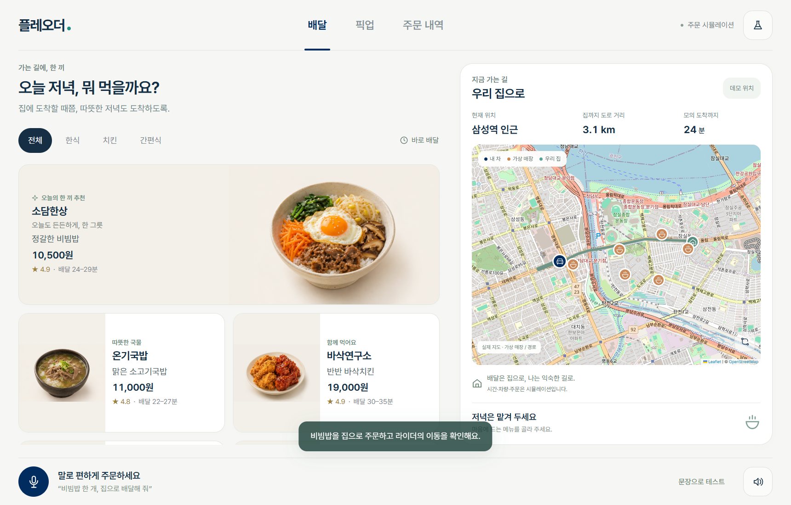

# 플레오더 · Pleorder

차에서 고르는 한 끼. 집으로 배달받거나, 귀가 중 매장에 들러 픽업하는 **Pleos Connect용 주문 시뮬레이터**입니다.



실제 음식점·결제사·배달 API는 연결하지 않습니다. 지도는 실제 서울 도로이며, 매장 6곳·집·차량·라이더·거래는 가상입니다. 외부 지도에 가짜 영업점을 등록하지 않습니다.

## 구현 범위

- 배달 / 픽업, 수량·같은 매장 메뉴 추가, 귀가 시점에 맞춘 배달, 주문 확인·취소·내역 복원
- 실제 OSM 지도 위 가상 매장, OSRM 도로 경로 13개, 경유 거리 비교, 차량·라이더 이동
- 모의 결제 수단, 잔액·한도 부족, 승인 거절, 결과 미확인, 중복 결제 방지, 취소·환불 대기·환불 완료
- 매장 거절·취소, 조리 지연, 라이더 배정 지연·재배정, 수령인 부재, 픽업 지연, 누락 문의
- 주문·결제 수단·금액·문제 상황을 설명하는 음성 안내와 실제 Pleos ON_DEVICE STT/TTS
- Gleo의 세 가지 공식 Broadcast/Callback 계약, 화면 없는 백그라운드 처리, 앱 내 `assets/schema.json`
- 시나리오 28개와 가속 시간, 1×/10×/60×, 5분 진행, 앱 재시작 복원

## 실행

Node.js가 있으면 별도 npm 의존성 설치 없이 미리볼 수 있습니다.

```powershell
npm test
npm run preview
```

브라우저에서 <http://127.0.0.1:4173>을 엽니다. 브라우저의 문장 입력은 로컬 규칙 기반 테스트이며 Gleo LLM이라고 표시하지 않습니다.

Android Studio에서 이 폴더를 열거나, JDK 21과 Android SDK 34 환경에서 빌드합니다.

```powershell
.\gradlew.bat :app:assembleDebug
adb install -r app\build\outputs\apk\debug\app-debug.apk
adb shell am start -n dev.pleorder.app/.MainActivity
```

현재 작업 컴퓨터에서는 Windows 한글 경로 문제를 피하는 아래 스크립트도 사용할 수 있습니다. 이 스크립트의 JDK/SDK 경로는 현재 컴퓨터 기준입니다.

```powershell
.\tools\Build-Pleorder.ps1 -Install
```

Pleos Emulator는 **주차 상태**에서 화면을 테스트하세요. 앱은 플랫폼의 주행 중 제한을 우회하지 않습니다.

## 구성

| 위치 | 역할 |
|---|---|
| `app/src/main/assets/web/core.js` | 주문 상태, 확인, 취소, 매장·배달 이벤트, 한국어 명령 |
| `app/src/main/assets/web/payments.js` | 모의 거래, 멱등성, 승인 결과 확인, 환불 |
| `app/src/main/assets/web/map.js` | 지도, 도로 경로, 가상 차량·라이더 |
| `app/src/main/assets/web/app.js` | 화면 상호작용과 Android 브리지 |
| `app/src/main/java/dev/pleorder/app` | 실제 Pleos 음성·위치·내비게이션 어댑터 및 Gleo 백그라운드 수신 |
| `app/src/main/assets/schema.json` | Gleo 기능 세 개 등록 계약 |
| `tests` | 주문·결제·이벤트의 회귀 검사 |

## Gleo 및 실제 SDK의 경계

Gleo는 외부 앱이 임의 프롬프트로 호출하는 공개 챗봇 API와 다릅니다. Gleo가 사용자 발화를 이해한 뒤 등록된 앱 기능을 Intent로 호출하고, 앱은 Callback으로 답합니다. 이 저장소에는 그 계약을 구현했습니다. **실제 Gleo 클라우드 대화 → 앱 호출의 종단 간 승인·성공을 주장하지 않습니다.** 공식 검토·활성화가 별도로 필요할 수 있습니다.

STT/TTS는 `3.3.1` ON_DEVICE 모드를 사용합니다. 서버 키를 소스나 APK에 넣지 않으며, 직접 서버 Speech API를 사용하는 코드도 없습니다. Gleo 서비스 전체의 무료 사용 또는 과금 조건을 보장하는 공식 근거는 확인하지 못했습니다.

FusedLocation은 실제 차량 좌표를 표시할 수 있습니다. **차량 GPS 모드의 실제 귀가 ETA·교통 상황·역지오코딩은 아직 연결하지 않았습니다.** 이때 데모 거리를 실제 거리처럼 표시하지 않고, 도착 시점 예약·경유 거리 비교를 제한합니다. 기본 테스트 경로는 명시적으로 표시된 데모입니다.

내비게이션은 사용자가 경유 요청을 확인한 후 NaviHelper를 호출합니다. 에뮬레이터에서 실제 안내 시작 Callback을 확인했습니다. Gleo 백그라운드 계약은 앱 프로세스를 종료한 상태에서도 준비·확정·중복 확정·조회가 작동하고 주문과 거래가 하나만 생성되는 것을 확인했습니다.

## 검증과 자료

- [실제 검증 범위](docs/testing/verification.md)
- [28개 시나리오](docs/testing/scenario-matrix.md)
- [설계와 실제 서비스 전환](docs/architecture.md)
- [이미지·폰트·지도 출처](docs/design/asset-provenance.md)

OSM 공개 타일·OSRM 데모 서버는 소규모 개발 확인에 사용합니다. 운영 트래픽은 별도 제공자 또는 자체 서버로 전환해야 합니다. 타일을 일괄 다운로드하지 않습니다.
