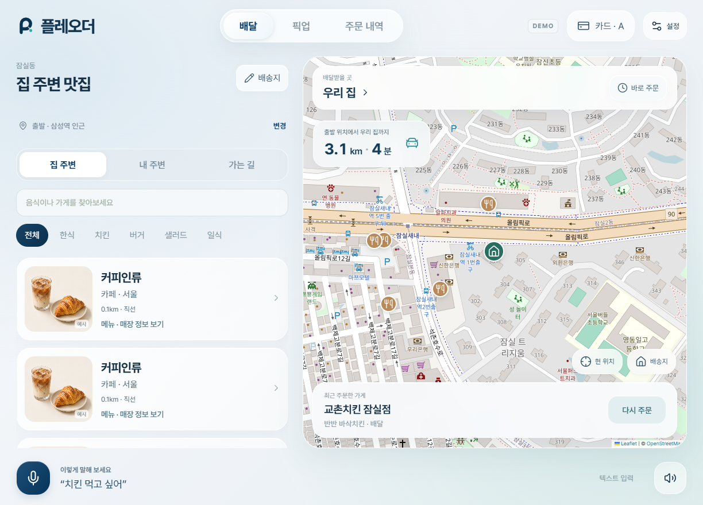

# 플레오더 · Pleorder

차에서 고르는 한 끼. 집으로 배달받거나, 귀가 중 매장에 들러 픽업하는 **Pleos Connect용 주문 시뮬레이터**입니다.



## 공모전 제출 자료 · 2026-11-12

아래 플레이어에서 전체 시연을 바로 재생할 수 있습니다. 재생 시 음소거를 해제하면 설명과 실제 SDK 음성 응답을 들을 수 있습니다. README용은 720p이며 원본 1080p 영상은 아래 링크에서 내려받습니다.

https://github.com/user-attachments/assets/0c0ab340-f5db-45e3-9ea2-515638212d8b

- [실제 기능 시연 영상 · 7분 16초](산출물/02_시연영상/플레오더_전체기능시연.mp4) · [장면별 설명](산출물/02_시연영상/장면별_설명.md)
- [기획서 PDF](산출물/01_기획서/플레오더_기획서.pdf) · [편집용 DOCX](산출물/01_기획서/플레오더_기획서.docx)
- [실행 release APK · GitHub Releases](https://github.com/kjhk3082/pleorder/releases/tag/contest-2026-11-12) · [설치와 설정](apk/README.md)
- [검증 결과와 한계](산출물/03_검증자료/검증결과.md) · [공식 제출 요건](산출물/04_제출안내/공식요건_체크리스트.md)

검증 환경은 Pleos `release_connect_v2.1.0`, Android API 34, x86_64, 2560 × 1440, density 160입니다. **출품 release는 공개 Pleos STT/TTS 3.3.1과 앱 내부 명령 처리를 사용**합니다. 공식 공지에 따라 실험용 Gleo Activity/Receiver를 release에서 비활성화했습니다. 기존 Gleo 연구 기록은 공모전 승인이나 현재 출품판의 지원 기능을 의미하지 않습니다.

서울 OpenStreetMap 공개 데이터의 음식점·카페 45,488곳을 검색하고, 주문·결제·차량 이동·라이더는 시뮬레이션합니다. 교촌 브랜드의 공식 메뉴 83개와 권장가를 수집했으며 지점별 판매 여부·실제 배달 가능 여부는 확인되지 않았습니다. 메뉴판이 없는 매장에는 임의의 실제 메뉴·리뷰를 만들지 않고, 별도 테스트 메뉴를 제공합니다. 외부 지도에 가짜 영업점을 등록하지 않습니다.

## 구현 범위

- 배달 / 픽업, 수량·같은 매장 메뉴 추가, 귀가 시점에 맞춘 배달, 주문 확인·취소·내역 복원
- 실제 OSM 매장 검색·정보·공식 메뉴와 별도 테스트 메뉴, 도로 경유 거리/시간, 차량·라이더 이동
- 테스트 카드 등록·해제·기본 수단, 슬라이드/명시적 음성 승인, A/B/C 카드별 승인·한도 부족·결과 확인, 중복 결제 방지·환불
- 매장 거절·취소, 조리 지연, 라이더 배정 지연·재배정, 수령인 부재, 픽업 지연, 누락 문의
- 주문·결제 수단·금액·문제 상황을 설명하는 공개 Pleos STT/TTS 음성 흐름
- 공용 백그라운드 주문 엔진, debug 전용 Gleo Activity/Callback 연구 계약
- 가게 → 메뉴 → 옵션의 여러 턴 대화, 완료 이력 기반 최근/평소 주문, 최대 3건 동시 주문과 대상별 조회
- 도착 맞춤 예약의 대기·전송·보류·재개, 경로 변경과 추적 공백 처리, 백그라운드 추적 서비스
- 완료 시간·문 앞 샘플 사진, 지역·최근 주문 추천, 주소 관리, 앱 재시작 복원
- 장소 검색·지도 핀 선택·상세주소 음성 입력, 차량 내비 목적지 조회와 숙소 주변 추천 제안
- 유리 질감 화면, 라이트/다크 테마, 모션 줄이기, 주문 음성 알림 설정
- 개발자 API에 28개 회귀 시나리오를 유지하며 일반 사용자 화면에서는 시나리오 선택기를 제거

## 실행

Node.js가 있으면 별도 npm 의존성 설치 없이 미리볼 수 있습니다.

```powershell
npm test
npm run preview
```

브라우저에서 <http://127.0.0.1:4173>을 엽니다. 브라우저의 문장 입력은 로컬 규칙 기반 테스트이며 Gleo LLM이라고 표시하지 않습니다.

Android Studio에서 이 폴더를 열거나, JDK 21과 Android SDK 34 환경에서 빌드합니다.

```powershell
.\gradlew.bat :app:assembleDebug
adb install -r app\build\outputs\apk\debug\app-debug.apk
adb shell am start -n dev.pleorder.app/.DrivingActivity
```

현재 작업 컴퓨터에서는 Windows 한글 경로 문제를 피하는 아래 스크립트도 사용할 수 있습니다. 이 스크립트의 JDK/SDK 경로는 현재 컴퓨터 기준입니다.

```powershell
.\tools\Build-Pleorder.ps1 -Install
```

Pleos Emulator에서 전체 탐색·설정은 **주차 상태**, 간결한 음성·주문 요약은 **주행 상태**로 테스트합니다. 앱은 플랫폼의 주행 제한을 우회하지 않습니다.

한국 출시를 대상으로 합니다. 지역별 제한은 국가명이나 D/P 기어를 하드코딩하지 않고 차량의 `CarUxRestrictions` 비트마스크를 적용합니다. 현재 에뮬레이터는 정차 D와 주행 D에서 `0x50`(동영상·설정 제한)을 반환합니다. DO를 선언한 별도 `DrivingActivity`와 주차용 `MainActivity`를 자동 전환합니다. 설치 후 기존 태스크를 종료하고 새 주행용 태스크로 실행하여 **D단 정차·콜드 실행·27km/h 에뮬레이터 주행 중 화면 표시**를 확인했습니다. 제품 심사나 실차 검증 완료를 의미하지 않습니다. [판정 차이와 검증](docs/testing/korea-driving-policy.md)을 참고하세요.

## 구성

| 위치 | 역할 |
|---|---|
| `app/src/main/assets/web/core.js` | 주문 상태, 확인, 취소, 매장·배달 이벤트, 한국어 명령 |
| `app/src/main/assets/web/payments.js` | 모의 거래, 멱등성, 승인 결과 확인, 환불 |
| `app/src/main/assets/web/order-assistant.js` | 여러 턴 대화, 옵션·수량 수정, 완료 주문 개인화 |
| `app/src/main/assets/web/order-scheduler.js` | ETA 기반 예약, 경로 변경 보류, 재개·전송 |
| `app/src/main/assets/web/map.js` | 지도, 도로 경로, 가상 차량·라이더 |
| `app/src/main/assets/web/app.js` | 화면 상호작용과 Android 브리지 |
| `app/src/main/java/dev/pleorder/app` | 실제 Pleos 음성·위치·내비게이션 어댑터 및 Gleo 백그라운드 수신 |
| `app/src/main/assets/schema.json` | Gleo 대화·주문·배송지 기능 여덟 개 등록 계약 |
| `tests` | 주문·결제·이벤트의 회귀 검사 |

## 공개 음성 SDK와 Gleo 연구의 경계

출품판에서는 마이크를 누르고 “비빔밥 한 개 배달해 줘” → 견적 확인 → “결제 승인” → “주문 상태 알려 줘”로 진행합니다. 음식 인식과 상품·수량·총액 확인은 구분됩니다. “평소에 자주 먹던 메뉴로 담아 줘”는 완료한 동일 구성 주문이 3회 이상 있어야 합니다. “집 도착 시간에 맞춰 주문 예약해 줘”로 예약하고, 보류된 예약은 “예약 재개” 또는 “주문 취소”로 처리합니다.

Gleo는 앱이 임의 프롬프트로 호출하는 공개 챗봇 API와 다릅니다. [공식 개발 범위 공지](https://appdevchallenge.auto-hmg.io/notice/c0a1a000-2026-4923-8000-000000000008)에 따르면 참가팀은 Gleo Interface(App Schema) 검토·승인을 신청할 수 없으며, 공개되지 않은 SDK와 Pleos LLM SDK도 제공되지 않습니다. 과거 에뮬레이터 연구는 [2026-11-09 기록](docs/testing/gleo-voice-e2e.md)으로 보존하되, 출품판의 승인된 Gleo 기능으로 제시하지 않습니다.

2026-11-12 공개 STT/TTS `3.3.1` ON_DEVICE 경로에서 합성 한국어 음성을 가상 마이크로 입력해 주문 준비 → 명시적 승인 → 현황 조회를 확인했습니다. 주문과 성공 거래는 각각 1건, 총액은 12,500원이었습니다. 실제 TTS 응답을 영상에 녹음했습니다. 일부 발화 오인식과 에뮬레이터 종료·연결 불안정이 재현되어 사람 목소리·반복 안정성·주소 음성 입력의 현재 실기 검증 완료를 주장하지 않습니다. 서버 키나 내부 모델을 APK에 넣지 않습니다.

FusedLocation은 실제 차량 좌표를 표시할 수 있습니다. 설정된 환경에서는 Naver 지도·주소 검색과 서버 프록시의 Directions 5 자동차 경로를 사용하며, 대체 제공자로 OSM/OSRM/Photon도 유지합니다. 현재 좌표와 일치하는 경로가 없으면 도착 맞춤 결제를 기다립니다. NaviHelper 목적지·남은 시간과 지도 경로를 구분해 사용합니다. 공개 주소 데이터는 불완전할 수 있어 사용자가 장소·주소·상세주소를 확인한 후 저장합니다. 경로 API의 계산 결과, 데모 경로, 직선 거리를 구분해 표시합니다.

내비게이션은 사용자가 경유 요청을 확인한 후 NaviHelper를 호출합니다. 이전 에뮬레이터 연구에서는 안내 시작 Callback과 Gleo 백그라운드 계약의 준비·확정·중복 확정·조회를 확인했습니다. 이 기록은 현재 출품판의 Gleo 승인 또는 이번 영상의 실제 내비 경로 반영 증거를 뜻하지 않습니다. 이번 영상의 픽업 장면은 전송 확인창까지입니다.

## 검증과 자료

- [팀원 소스 통합·대화·예약·실제 Gleo 검증](docs/testing/team-integration-2026-11-09.md)
- [제품 빈틈과 다음 설계](docs/product/2026-11-09-product-gap-review.md)
- [실제 검증 범위](docs/testing/verification.md)
- [28개 시나리오](docs/testing/scenario-matrix.md)
- [설계와 실제 서비스 전환](docs/architecture.md)
- [이미지·폰트·지도 출처](docs/design/asset-provenance.md)

OSM 공개 타일·OSRM·Photon 데모 서버는 소규모 개발 확인에 사용합니다. 운영 트래픽은 별도 제공자 또는 자체 서버로 전환해야 합니다. 타일을 일괄 다운로드하지 않습니다. 매장 데이터는 ODbL 출처·원본 링크를 표시하며, 도시 내 모든 영업점의 최신 상태를 보장하지 않습니다.

목적지·동호수 Gleo 입력: [검증 및 동작](docs/testing/voice-addresses.md). 개발 도구 위치: [로컬 환경](docs/testing/local-toolchain.md).
