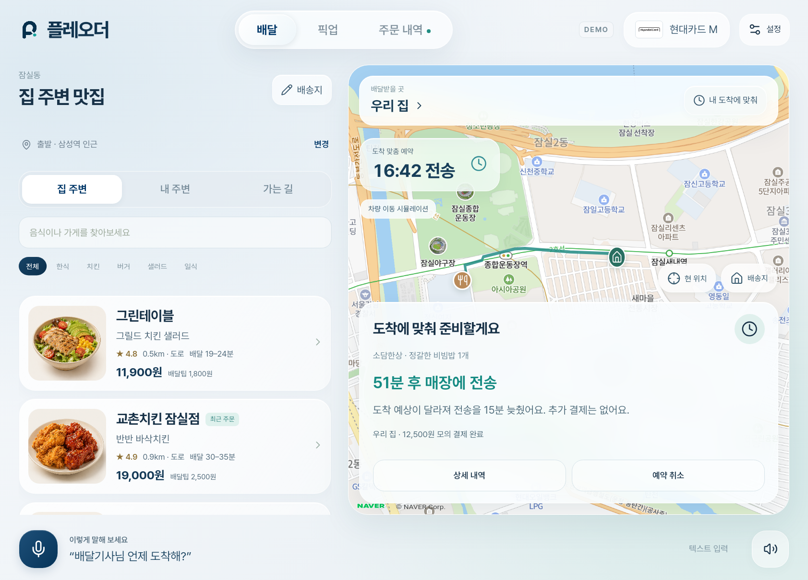
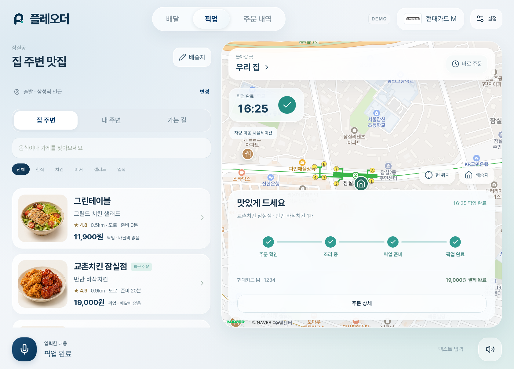
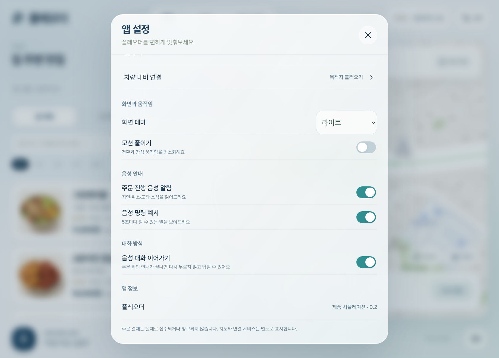
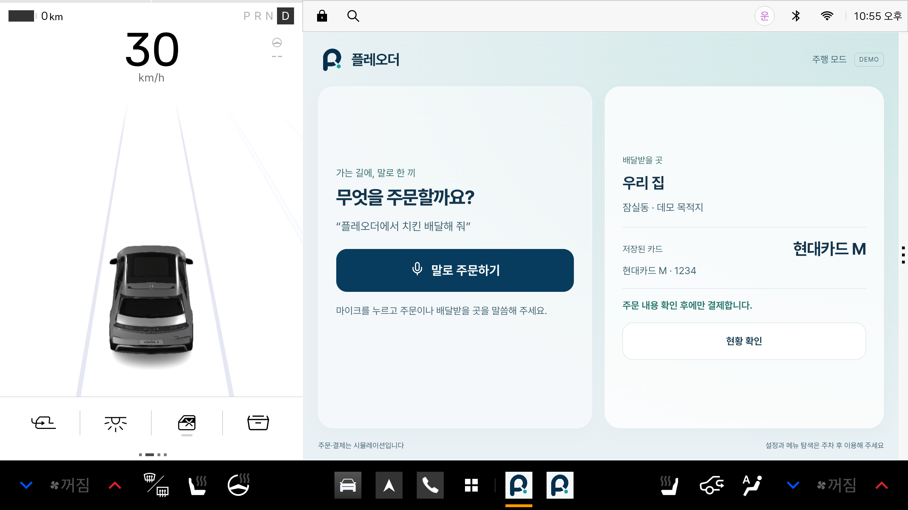

# 팀 피드백 반영과 검증

확인일: 2026-11-13. 1차 제출 범위는 배달과 일반 매장 픽업입니다. DT 주문은 빌트인 CarPay와의 기능 중복 및 별도 사업자 API가 필요한 점을 고려해 제외했습니다. 1차 통과 이후 재검토합니다.

## 공개 기능과 향후 연동

[공식 공지](https://appdevchallenge.auto-hmg.io/notice/c0a1a000-2026-4923-8000-000000000008)는 참가팀의 Gleo Interface 및 App Schema 검토·승인 신청을 허용하지 않습니다. 현재 release는 공개 SpeechToText/TextToSpeech 3.3.1과 앱의 명령 엔진을 사용합니다. 실험용 Gleo 진입점은 비활성 상태입니다.

영상의 Gleo → 플레오더 카드는 **향후 승인 후 연동 계획**입니다. 실제 호출에 성공한 화면이나 승인된 기능을 흉내 내지 않았습니다. 승인 후에는 주문 요청을 차량 상태에 맞는 플레오더 화면으로 연결하고, 단순 현황 조회는 불필요한 화면 전환 없이 응답하는 방향을 검토합니다.

## 코드에 반영한 내용

- 음성으로 주문·메뉴 선택을 진행하면 TTS 안내가 끝난 뒤 응답용 마이크를 한 번 자동으로 엽니다. 별도 결제 승인은 계속 필요합니다. 설정에서 끌 수 있습니다.
- 응답 대기는 45초 후 만료되며, 화면 닫기·다른 조작·백그라운드·음성 오류 때 취소합니다. TTS 종료 콜백이 중복돼도 한 번만 다시 듣습니다.
- 마이크 초기화 중에도 즉시 준비 중 상태와 취소 조작을 표시합니다.
- 차량 ETA 변화는 미전송 예약에만 적용합니다. 큰 변화는 전송 조정 이유와 추가 결제 없음을 알립니다. 이미 접수된 주문은 조리 전으로 되돌리지 않습니다.
- 차량 ETA가 90초 이상 오래됐거나 미래 시각이면 전송을 보류합니다. 최신 정보가 없으면 재개 성공으로 안내하지 않습니다. 목적지 변경도 기존 배송지를 임의로 덮어쓰지 않습니다.
- 픽업 준비 음성은 수령 뒤 ‘픽업 완료’라고 말하도록 안내합니다.
- 지도 연결 오류가 `Failed to fetch` 같은 내부 오류로 노출되지 않게 수정했습니다.

## 디자인 검수

[Pleos UI 가이드](https://document.pleos.ai/docs/connect/guide/docs-design/Introduction/intro)와 [운전자 주의분산 가이드](https://document.pleos.ai/docs/pleos-only/vehicle-app-planning-guide/driver-distraction-guideline)를 기준으로, 주차용 탐색 화면과 DO 주행 화면을 분리해 검수했습니다. 한국 출시 대상이며 실제 CarUxRestrictions가 우선입니다. 속도나 기어만으로 제한을 해제하지 않습니다.

| Before | After | Why |
|---|---|---|
| 주문 확인마다 마이크를 다시 누름 | 안내 종료 후 한 번 응답 대기, 취소·만료 지원 | 터치 수를 줄이면서 명시적 승인 유지 |
| 긴 음성 문장이 주행 화면을 차지할 수 있음 | 화면 요약을 최대 3줄로 제한하고 전체 설명은 TTS로 전달 | 짧게 보고 핵심 상태를 파악 |
| 예약 설명과 시간이 반복돼 버튼이 접힘 | 전송 시각·변경 이유·기존 결제만 간결하게 표시 | 주차 화면에서 상세·취소 버튼 가시성 확보 |
| 주행 모션의 CSS 차단 범위가 제한적 | DO 화면의 애니메이션·전환·부드러운 스크롤 일괄 중지 | 시선 유도와 반복 움직임 최소화 |
| 경로 연결 실패가 영문 기술 오류로 표시 | 한국어 재시도 안내 | 사용자가 복구 방법을 이해 |

현재 에뮬레이터 화면에서 간격·잘림·버튼을 확인했습니다. 물리적 mm 크기, 실차의 햇빛·야간 대비, 운전자 시선 분산을 실측한 인증 결과는 아닙니다.

## 재현한 과업

1. 픽업 시나리오 → 치킨 주문 → 슬라이드 승인 → 내비 전송 확인창 → 시험 시계 +35분 → 준비 완료 → 픽업 완료. 주문 completed, 결제 1건을 확인했습니다. 내비 경로 반영 성공은 이번 촬영의 주장에 포함하지 않습니다.
2. 도착 맞춤 배달 → 모의 결제 → 차량 ETA 시험 입력 60분 → 75분. 전송이 15분 늦춰지고 기존 시점에도 대기하는 것을 확인했습니다. 시험 시계를 더 진행한 뒤 매장 전송 1회, 결제 1건을 확인했습니다.
3. 카드 관리 → 설정 → 음성 대화 이어가기 항목. 설정값과 화면을 확인했습니다.
4. 회귀 검사 136개 통과: 예약 재조정·기접수 주문 보호·오래된 ETA 재개 거절·마이크 재진입 제한 포함.

정체 영상은 시험용 NaviHelper 형식 이벤트를 실제 앱에 전달하며, 해당 촬영 동안 실제 내비 상태 콜백과 섞이지 않도록 테스트 도구에서 격리합니다. **실시간 교통정보 수신 영상이 아닙니다.** 시간 가속·텍스트 명령 입력도 자막으로 구분합니다.

음성 장면은 11월 12일 debug에서 공개 SDK로 검증한 가상 마이크 기록입니다. 연속 대화의 새로운 release 전체 음성 반복 검증을 대신하지 않습니다. 최신 release 실기 범위와 미완료 항목은 [제출 검증 결과](../../산출물/03_검증자료/검증결과.md)에 기록합니다.

## 화면 증거

